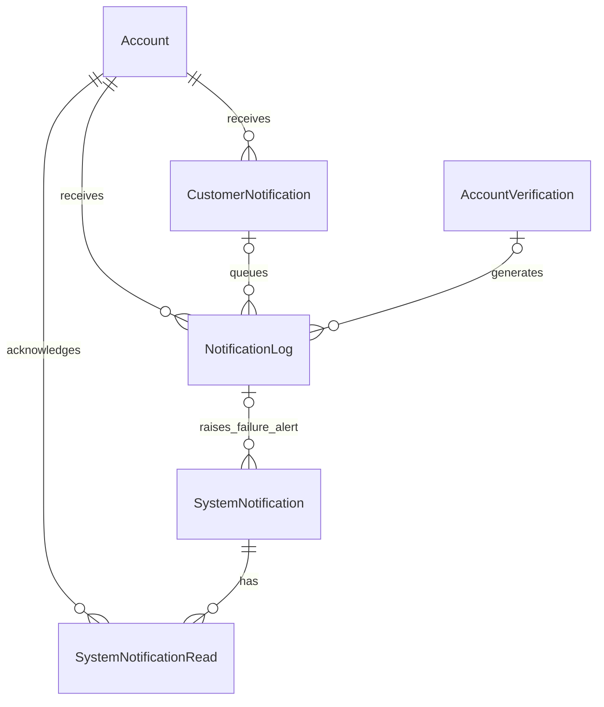
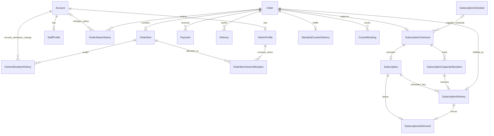

# Kitchen406 Entity Relationship Design

This ERD records the current SQLite v7 implementation and the target design. Rows marked **SQLite** describe local tables. Rows marked **SQLite subset** include target fields or constraints alongside the implemented entity. The implementation notes below give the physical keys, statuses, and table names wherever they differ.

## Current SQLite behavior

- [Authentication schema](database/auth.sql) covers accounts, role profiles, verification challenges, sessions, staff status history, and encrypted temporary staff passwords. A pending staff setup is represented by an active account with `StaffProfile.is_temp_pass_changed = 0`. Public password recovery is for active customers. For email changes, `AccountVerification.target_email` holds the proposed address and `delivery_email` holds the destination for the code. Customers receive the code at the proposed address. Staff and admins receive it at their current address, and saving the proposed address clears `email_verified_at` for these roles.
- [Inventory and catalog schema](database/inventory.sql) links categories, products, variants, bills of materials, and inventory. Category management saves to SQLite. The product editor saves product details, variants, final selling prices, recipes, uploaded covers, and applicable subscription schedule changes in one transaction. Suggested prices and default markup and utility overhead settings use browser state. Hiding a category removes its Shop filter, while the Shop continues to list its active products under All Products. Both checkout APIs currently require an active category. The internal inventory snapshot is restricted to admins and staff who have completed setup.
- Physical counts and restocks update stock and write the corresponding movement in one transaction. Restocks use weighted-average unit cost. The API tracks mutation keys in InventoryOperation to make repeat submissions idempotent.
- SQLite derives stock status from physical stock and the reorder threshold. The API checks for zero physical stock and active reservations before archiving. Archiving preserves movement history, recipes, and material requirements. Removal requires zero stock and no movement, recipe, or requirement references. The edit API locks a material’s unit once it has movement history or recipe usage. A recipe save can retain an existing archived material at its original quantity or remove it. The owner’s active reservation panel displays browser-session reservations.
- [Ordering migration v3](database/ordering-v3.sql) persists standard pickup orders, price and recipe snapshots, order status history, blocked dates, standard capacity, checkout holds, and demo payments. The schema implements the pickup subset of the target entities below and stores prices in integer centavos.
- Standard and subscription checkout use a 30-minute demo payment session and a 32-minute resource hold. Cancellation or hold expiry releases capacity and ingredients. [Pickup fulfillment migration v4](database/pickup-fulfillment-v4.sql) records pickup progress, arrival, and completion. Starting preparation consumes confirmed ingredient reservations and writes linked stock movements in one transaction.
- [Subscription migration v5](database/subscriptions-v5.sql) extends the shared Order, OrderItem, Payment, CheckoutHold, and history tables. A purchase holds four dates and the first cycle's ingredients. Demo payment confirmation atomically activates one subscription and four linked fulfillment orders. Each child has a zero payable amount and its prepaid product revenue in `OrderItem.net_product_cents`.
- Orders shows the four fulfillment records. The subscription details show the upfront payment reference and price breakdown. The payment ledger and sales reports use the prepaid purchase record.
- Subscription checkout snapshots the selected schedule, address, and four fees. Eligible products use their active catalog schedule, or Thursday preparation and Friday fulfillment when the product has no configured schedule. Delivery checkout requires a current server-signed quotation. Pricing and capacity are checked server-side.
- Admins manage subscription eligibility and save weekdays in Products. Preparation and fulfillment must use different weekdays. An active offering takes effect for new checkouts when saved. Existing holds and paid cycles keep their dates. A stale checkout returns the customer to setup to review the current dates and refresh any courier quotation before payment.
- The first cycle uses its checkout reservation. Later cycles store ingredient requirements at activation and try to reserve stock from the day before preparation during subscription API activity. Starting preparation retries shortages and consumes reserved stock atomically. Pickup arrival and completion use PickupFulfillment. A missed Ready pickup is cancelled after the Manila cutoff when the subscription API next runs.
- A single deferment retains the original date and allocation, creates a replacement allocation, and updates the linked fulfillment and material requirement dates in the same transaction. This preserves the prepaid amounts. The subscription becomes completed when all four cycles are fulfilled.
- [Courier migration v6](database/courier-v6.sql) adds saved delivery addresses and standard courier fulfillment. Standard and subscription delivery checkout validates a server-signed quote and snapshots the address and fees. Both use the shared `CourierBooking` table for simulated booking, reconciliation, tracking, and completion. Customer, owner, and eligible staff views read their authorized records from SQLite.
- Live payment, live courier booking, stock consumption reversal, cake quotations, and owner allocations remain in the target design.

### SQLite v7 table mapping

| Design area | Current SQLite storage |
| --- | --- |
| Saved addresses (`Address`) | `SavedDeliveryAddress` stores a customer FK, address data as JSON, a default flag, and timestamps. A partial unique index permits at most one default per customer. The address book deletes removed rows and selects another default when needed. Checkout keeps its own address snapshot. |
| Courier fulfillment (`Delivery`) | `StandardCourierDelivery` stores the standard order FK as its PK, the address snapshot, fee in centavos, preparation status, and completion time. Subscription checkout stores the address and four fees in `SubscriptionCheckout`. The shared `CourierBooking` references the standard or subscription fulfillment order and stores the operation key, simulated outcome, status, and timestamps. A partial unique index covers pending, booked, in-transit, and delivered bookings. It replaces the v5 `SubscriptionCourierBooking` table. |
| Order status and completion | `Order.status` is `pending_payment`, `confirmed`, or `cancelled`. Preparation and completion are tracked by `PickupFulfillment`, `StandardCourierDelivery`, or `SubscriptionDelivery`. Courier progress lives in `CourierBooking`. `OrderStatusHistory` records transitions. Completion timestamps are `completed_at` for standard pickup and courier fulfillment and `fulfilled_at` for subscription cycles. |
| Order and payment amounts | `Order.total_cents`, generated `Order.amount_payable_cents`, `OrderItem.unit_price_cents`, `OrderItem.net_product_cents`, and `Payment.amount_cents` store amounts in integer centavos. The demo payment statuses are `pending`, `paid`, `expired`, and `cancelled`. The payment and resource hold have separate expiry times. |
| Standard capacity and blocked dates | `CapacityConfig` is keyed by `order_type` and holds the standard daily variety and unit limits. `CapacityAllocation` references the configuration by `order_type` and requires a product, source order, and hold. The standard cutoff is applied by the server. `BlockedDate` uses `date` as its primary key, with a nullable reason and creating admin FK plus a creation timestamp. |
| Stock reservations and consumption | `InventoryReservation` requires a checkout hold FK and uses `held`, `confirmed`, `released`, and `expired`. The hold supplies the expiry for held reservations. A unique link from a `consumption` movement identifies the confirmed reservation that was consumed. Stock checks exclude consumed reservations from the reserved balance. |

The BPMNs show [standard checkout and pickup](BPMNs/standard-order-checkout-and-pickup.bpmn.xml), [subscription checkout and activation](BPMNs/subscription-checkout-and-activation.bpmn.xml), [subscription cycle fulfillment and deferment](BPMNs/subscription-cycle-fulfillment-and-deferment.bpmn.xml), [courier address and fulfillment](BPMNs/courier-address-and-fulfillment.bpmn.xml), and the shared [stock validation and reservation](BPMNs/inventory-stock-validation-and-reservation.bpmn.xml) rules.

## Entities

| Entity | Attributes and constraints |
| ----- | ----- |
| **Account** · SQLite | `account_id` PK; `email` case-insensitive UNIQUE; `password_hash`; `first_name`; `last_name`; `role` {customer, staff, admin}; `status` {pending\_verification, active, inactive, suspended}; `email_verified_at` nullable; `password_changed_at` nullable; `created_at`; `updated_at` |
| **AdminProfile** · SQLite | `admin_id` PK; `account_id` FK, UNIQUE → Account; `is_baking_owner` default false. Only designated baking owners may receive earnings allocations; account role remains admin.  |
| **StaffProfile** · SQLite | `staff_id` PK; `account_id` FK, UNIQUE → Account; `is_temp_pass_changed` default false; `created_by_admin_id` FK → AdminProfile; `version` integer default 0; `created_at`; `updated_at` |
| **StaffStatusHistory** · SQLite | Composite PK (`staff_id`, `version`); `staff_id` FK → StaffProfile; `admin_id` FK → AdminProfile; `status` {active, inactive}; `changed_at` |
| **StaffTemporaryPassword** · SQLite | `staff_id` PK and FK → StaffProfile; `encrypted_password` BLOB; `nonce` BLOB; `auth_tag` BLOB |
| **CustomerProfile** · SQLite | `customer_id` PK; `account_id` FK, UNIQUE → Account; `mobile_number`; `created_at`; `updated_at` |
| **AccountVerification** · SQLite | `account_verification_id` PK; `account_id` FK → Account; `purpose` {email\_verification, password\_reset, email\_change, account\_setup}; `otp_code_hash`; `target_email` nullable; `delivery_email` nullable; `expires_at` epoch milliseconds; `verified_at` nullable; `attempt_count` default 0, CHECK 0–5; `created_at` epoch milliseconds |
| **AuthSession** · SQLite | `token_hash` PK; `account_id` FK → Account; `expires_at` epoch milliseconds. Each session belongs to exactly one Account. An Account can have zero or more sessions. |
| **Address** | `address_id` PK; `customer_id` FK → CustomerProfile; `label`; `add_line_1`; `add_line_2` nullable; `city`; `postal_code`; `landmark` nullable; `latitude`; `longitude`; `is_default` default false; `status` {active, archived}; `created_at`; `updated_at` |
| **Category** · SQLite | `category_id` PK; `category_name` case-insensitive UNIQUE; `status` {active, inactive}; `created_at`; `updated_at` |
| **Product** · SQLite | `product_id` integer PK; `category_id` FK → Category; `name`; `description`; `img_url`; `subscription_eligible` boolean stored as 0 or 1; `status` {active, inactive}; `created_at`; `updated_at` |
| **ProductCoverAsset** · SQLite | `image_id` PK; `content_type` {image/jpeg, image/png, image/webp}; `content` BLOB. Uploaded covers are served by ID and referenced through `Product.img_url`. |
| **ProductVariant** · SQLite | `variant_id` PK; `product_id` FK → Product; `variant_key`; UNIQUE (`product_id`, `variant_key`); `size` (variant label); `final_price` CHECK > 0; `utility_overhead` nullable, CHECK ≥ 0. Suggested price is derived from material costs, effective utility overhead, and markup; `status` {available, unavailable}; `created_at`; `updated_at` |
| **PricingConfig** | `pricing_config_id` PK; `default_utility_overhead`; `markup_percentage`; `updated_by_admin_id` FK → AdminProfile; `created_at`; `updated_at` |
| **Inventory** · SQLite | `inventory_id` PK; `name` UNIQUE case-insensitive; `material_type` {ingredient, packaging}; `unit` {g, ml, pcs}; `stock_on_hand`, `reorder_threshold`, and `cost_per_unit` each CHECK ≥ 0; `status` {available, unavailable, low\_stock}; `archived_at` nullable; `created_at`; `updated_at`. **Target rules:** Recompute stock status whenever physical stock, active reserved quantity, or the reorder threshold changes. Available stock at or below zero is unavailable, positive available stock at or below the threshold is low stock, and available stock above the threshold is available. A populated `archived_at` marks an archived material independently of stock status. The base unit is locked once a material has a movement, recipe, or material requirement. |
| **ProductBOM** · SQLite | `product_bom_id` PK; `variant_id` FK → ProductVariant; `inventory_id` FK → Inventory; `quantity_required` CHECK > 0 in the inventory item's base unit; UNIQUE (`variant_id`, `inventory_id`). The same material may appear in multiple variants. |
| **Cart** | `cart_id` PK; `customer_id` FK, UNIQUE → CustomerProfile; `subtotal`; `created_at`; `updated_at`. `subtotal` is system-maintained from CartItems. |
| **CartItem** | `cart_item_id` PK; `cart_id` FK → Cart; `variant_id` FK → ProductVariant; `quantity`; `added_at`; `updated_at`; UNIQUE (`cart_id`, `variant_id`) |
| **Order** · SQLite subset | `order_id` PK; `customer_id` FK → CustomerProfile; `cart_id` FK nullable → Cart; `address_id` FK nullable → Address; `address_snapshot` nullable; `ref_number` UNIQUE; `type` {standard\_purchase, subscription\_purchase, subscription\_fulfillment, custom\_cake\_purchase}; `total`; `amount_payable`; `placed_at`; `fulfillment_date` nullable; `production_date` nullable (custom cake purchases only); `fulfillment_method` {pickup, delivery} nullable; `status` {pending\_payment, confirmed, preparing, ready, out\_for\_delivery, completed, cancelled, payment\_resolution\_required}; `created_at`; `updated_at`; `completed_at` nullable; `customer_received_at` nullable (time the customer confirms receipt of a standard order); `handoff_failure_reason` nullable; `owner_allocation_locked_at` nullable. For owner-managed custom cake deliveries, an unsuccessful handoff leaves the order incomplete and stores the latest failure reason; successful handoff sets the status to completed and records the actual handoff time in `completed_at`. No separate attempt history is maintained. Completion timestamps support fulfilled-sales reporting; attribution locks on active courier booking or completion.  |
| **OrderStatusHistory** · SQLite | `history_id` PK; `order_id` FK → Order; `status`; `changed_by_account_id` FK nullable → Account; `changed_at` |
| **OrderItem** · SQLite subset | `order_item_id` PK; `order_id` FK → Order; `variant_id` FK nullable → ProductVariant; `quotation_id` FK nullable, UNIQUE → CustomCakeQuotation; `quantity`; `unit_price_snapshot`; CHECK exactly one of `variant_id` or `quotation_id` is populated; `net_product_amount_snapshot` (decimal currency, delivery fees excluded, after product discounts). For subscription fulfillment items this is their apportioned share of the actual prepaid product consideration, rather than a second payment.  |
| **OrderItemOwnerAllocation** | `owner_allocation_id` PK; `order_item_id` FK -> OrderItem; `admin_id` FK -> AdminProfile; `share_percentage` integer CHECK 1-100; `created_at`; `updated_at`; UNIQUE (`order_item_id`, `admin_id`). Only designated baking owners are eligible. A fully assigned item has one or two rows whose percentages total exactly 100. |
| **OwnerAllocationHistory** | `allocation_history_id` PK; `order_item_id` FK -> OrderItem; `changed_by_account_id` FK -> Account; `allocation_before` structured snapshot; `allocation_after` structured snapshot; `changed_at`. Each snapshot contains owner IDs and percentages; an empty snapshot represents unallocated work. Append-only audit of attribution edits, separate from status transitions. |
| **CheckoutHold** · SQLite subset | `hold_id` PK; `order_id` FK → Order; `status` {active, confirmed, released, expired}; `created_at`; `expires_at`; `confirmed_at` nullable; `released_at` nullable. Only one active hold per Order. |
| **Payment** · SQLite subset | `payment_id` PK; `order_id` FK → Order; `hold_id` FK, UNIQUE → CheckoutHold; `paymongo_id` UNIQUE; `amount`; `qr_img_url`; `status` {pending, paid, failed, expired, cancelled}; `failure_code` nullable; `failure_message` nullable; `created_at`; `expires_at`; `paid_at` nullable. **No refund handling exists in the system.** |
| **Delivery** | `delivery_id` PK; `order_id` FK → Order; `lalamove_id` UNIQUE nullable; `longitude`; `latitude`; `fee`; `status` {pending, booked, in\_transit, delivered, failed, cancelled}; `delivered_at` nullable; `created_at`; `updated_at`. Only one active delivery booking per Order. Applies only to courier delivery of standard and subscription fulfillment orders; no Lalamove booking or Delivery record is created for owner-managed custom cake delivery or pickup. |
| **CapacityConfig** · SQLite subset | `capacity_config_id` PK; `order_type` {standard, subscription, custom\_cake} UNIQUE; `max_varieties_per_day` nullable; `max_cakes_per_week` nullable; `max_cakes_per_day` nullable; `max_subscriptions_per_week` nullable; `max_units` nullable; `cutoff_time`; `lead_time_value`; `lead_time_unit` {hours, days}; `created_by_admin_id` FK → AdminProfile; `created_at`; `updated_at` |
| **CapacityAllocation** · SQLite subset | `allocation_id` PK; `capacity_config_id` FK → CapacityConfig; `product_id` FK nullable → Product; `source_order_id` FK → Order; `fulfillment_order_id` FK nullable → Order; `hold_id` FK nullable → CheckoutHold; `cycle_number` nullable; `fulfillment_date`; `quantity`; `status` {held, confirmed, fulfilled, released, expired}; `expires_at` nullable; `created_at`; `released_at` nullable |
| **BlockedDate** · SQLite subset | `blocked_date_id` PK; `date` UNIQUE; `reason` nullable; `created_by_admin_id` FK → AdminProfile; `created_at` |
| **SubscriptionSchedule** · SQLite | schedule_id PK, product_id FK → Product, preparation_day, fulfillment_day, status, created_by_admin_id FK → AdminProfile, created_at, updated_at |
| **Subscription** · SQLite | subscription_id PK, customer_id FK → CustomerProfile, variant_id FK → ProductVariant, purchase_order_id UNIQUE FK → SubscriptionCheckout, product_total_cents, delivery_fee_total_cents, status, created_at, updated_at. Quantity per cycle comes from the purchase item quantity divided by four. |
| **SubscriptionDelivery** · SQLite | subscription_delivery_id PK, subscription_id FK → Subscription, fulfillment_order_id UNIQUE FK → Order, allocation_id UNIQUE FK → SubscriptionCapacityAllocation, cycle_number (1–4), original_scheduled_date, scheduled_date, preparation_date, status, fulfilled_at (nullable), created_at, updated_at. Unique subscription and cycle. Activation writes exactly four rows. |
| **SubscriptionDeferment** · SQLite | subscription_id PK and FK → Subscription, subscription_delivery_id UNIQUE, original_allocation_id and replacement_allocation_id FK → SubscriptionCapacityAllocation, original_scheduled_date, new_scheduled_date, deferment_option (next_day or next_week), created_at. Unique replacement allocation. Composite foreign key to SubscriptionDelivery ensures the moved cycle belongs to the subscription. |
| **SubscriptionCheckout** · SQLite | purchase_order_id PK and FK → Order, optional schedule_id FK → SubscriptionSchedule, preparation_day and fulfillment_day snapshots, start_date, method, address_snapshot JSON, fee_snapshot JSON containing four centavo amounts. |
| **SubscriptionCapacityConfig** · SQLite | Singleton row storing weekly units per product and the subscription lead time and cutoff. |
| **SubscriptionCapacityAllocation** · SQLite | allocation_id PK, purchase_order_id FK → SubscriptionCheckout, hold_id FK → CheckoutHold, cycle_number, scheduled_date, status. A partial unique index permits one held or confirmed allocation per purchase and cycle. |
| **CourierBooking** · SQLite | `booking_id` PK; `order_id` FK → Order; `operation_key` UNIQUE; `status` {pending, booked, in_transit, delivered, failed, cancelled}; `outcome` (simulated); `created_at`; `updated_at`. Courier transitions are recorded in OrderStatusHistory. |
| **PickupFulfillment** · SQLite | order_id PK and FK → Order, status, arrived_at, arrived_by_account_id FK → Account, completed_at. Used by standard and subscription pickup orders. |
| **OrderMaterialRequirement** · SQLite subset | `requirement_id` PK; `order_id` FK → Order; `inventory_id` FK → Inventory; `quantity_required`; `fulfillment_date`; `reserve_at`; `created_at`; UNIQUE (`order_id`, `inventory_id`). Represents the aggregated ingredient requirement for that specific fulfillment Order. |
| **InventoryReservation** · SQLite subset | `reservation_id` PK; `requirement_id` FK → OrderMaterialRequirement; `hold_id` FK nullable → CheckoutHold; `quantity`; `status` {held, confirmed, consumed, released, expired}; `expires_at` nullable; `created_at`; `consumed_at` nullable; `released_at` nullable. Only one active held/confirmed reservation per requirement. |
| **InventoryMovement** · SQLite subset | `movement_id` PK; `inventory_id` FK → Inventory; `order_id` FK nullable → Order; `reservation_id` FK nullable → InventoryReservation; `performed_by_account_id` FK nullable → Account; `movement_type` {consumption, consumption\_reversal, restock, adjustment}; `quantity_change` CHECK ≠ 0; `unit_cost_snapshot` nullable; `reason` {spoilage, damage, miscount, theft, correction, other} nullable; `notes` nullable; `operation_key` UNIQUE; `occurred_at`. Every physical stock change and corresponding `stock_on_hand` update occurs atomically. SQLite supports restock, adjustment, and consumption. Consumption requires order and reservation FKs and a negative quantity. Each reservation can have one linked consumption movement. Consumption reversal remains a target extension. |
| **InventoryOperation** · SQLite | `operation_key` PK; `account_id` FK → Account; `signature` captures the action and submitted payload for idempotency. The same account and identical payload may retry the key. |
| **CustomCakeRequest** | `custom_request_id` PK; `customer_id` FK → CustomerProfile; `address_id` FK nullable → Address; `shape_option_id` FK → CakeOption; `flavor_option_id` FK → CakeOption; `size_option_id` FK → CakeOption; `color_option_id` FK → CakeOption; `icing_option_id` FK → CakeOption; `accepted_quotation_id` FK nullable, UNIQUE → CustomCakeQuotation; `ref_number` UNIQUE; `design_description`; `estimated_price`; `requested_date`; `requested_delivery_window` {morning, afternoon, evening}; `fulfillment_method` {pickup, delivery} nullable; `status` {pending\_review, negotiating, quoted, accepted, rejected, expired}; `expires_at`; `created_at`; `updated_at`. Unaccepted requests expire at the configured deadline; evaluate the seven-calendar-day lead time using the original submission date (`created_at`). |
| **CakeRequestImage** | `cake_request_image_id` PK; `custom_request_id` FK → CustomCakeRequest; `img_url`; `created_at`. Each submitted request must have one to three reference images. |
| **CakeOption** | `option_id` PK; `created_by_admin_id` FK → AdminProfile; `option_type` {shape, flavor, size, color, icing}; `scale_factor` nullable; `option_name`; `price`; `status` {available, unavailable}; `created_at`; `updated_at` |
| **CakeOptionIngredient** | `option_ingredient_id` PK; `option_id` FK → CakeOption; `inventory_id` FK → Inventory; `quantity_required`; UNIQUE (`option_id`, `inventory_id`) |
| **QuotationAddonIngredient** | `addon_ingredient_id` PK; `quotation_id` FK → CustomCakeQuotation; `inventory_id` FK → Inventory; `quantity_required` CHECK > 0; UNIQUE (`quotation_id`, `inventory_id`). Owner-selected additional ingredients in the Inventory measurement unit for this quotation version. Include these quantities in the accepted quotation's material requirements, in addition to predefined cake-option ingredients. |
| **CustomCakeQuotation** | `quotation_id` PK; `custom_request_id` FK → CustomCakeRequest; `version_number`; `created_by_admin_id` FK → AdminProfile; `fulfillment_date`; `delivery_window` {morning, afternoon, evening}; `fulfillment_method` {pickup, delivery}; `address_snapshot` nullable; `options_total`; `addons_total`; `complexity_charge`; `delivery_fee`; `total`; `status` {draft, issued, superseded, accepted, rejected, expired}; `issued_at` nullable; `expires_at` nullable; `accepted_at` nullable; `created_at`; UNIQUE (`custom_request_id`, `version_number`). Only the Admin/Owner configures optional additional inventory ingredients and their quantities during quotation preparation. The `addons_total` reflects the charge for these extras, and issued quotation versions retain their associated ingredient quantities. |
| **CustomerNotification** · SQLite subset | `customer_notification_id` PK; `recipient_account_id` FK → Account; `event_key`; `category` {orders, payments, subscriptions, cakes, account}; `title`; `message`; `related_entity_type`; `related_entity_id`; `created_at`; `read_at` nullable; UNIQUE (`recipient_account_id`, `event_key`). Each row belongs to one customer account. A null `read_at` means unread. |
| **NotificationLog** · SQLite subset | `notification_log_id` PK; `recipient_account_id` FK → Account; `type` {order\_confirmed, order\_status\_update, delivery\_status\_update, subscription\_delivery\_reminder, subscription\_delivery\_deferred, subscription\_status\_update, custom\_cake\_status\_update, subscription\_renewal\_reminder, email\_verification\_otp, password\_reset\_otp, account\_setup}; `provider` {brevo, semaphore}; `status` {pending, sent, failed}; `provider_message_id` nullable; `retry_count` default 0; `next_retry_at` nullable; `attempt_history` structured list; `error_message` nullable; `sent_at` nullable; `related_entity_type` {order, subscription, subscription\_deferment, custom\_cake\_request, delivery, payment, account\_verification}; `related_entity_id`; `created_at`. Each provider channel is tracked separately. Preserve each attempt outcome, time, provider message ID and error (if any) in `attempt_history`. Automatically retry failures up to three times, after 5, 15 and 30 minutes respectively; stop on success. Clear `next_retry_at` when sent or retries are exhausted; alert the Admin/Owner on final failure and allow manual retry without erasing attempt history. |
| **SystemNotification** · SQLite subset | `system_notification_id` PK; `recipient_role` {admin, staff, all}; `notification_type` {new\_order, custom\_cake\_submitted, low\_stock\_alert, subscription\_deferment\_completed, payment\_received, notification\_send\_failed}; `message`; `related_entity_type` {order, custom\_cake\_request, inventory, subscription, subscription\_deferment, payment, notification\_log}; `related_entity_id`; `created_at`. Read status is maintained separately for each eligible recipient in SystemNotificationRead. |
| **SystemNotificationRead** · SQLite | `notification_read_id` PK; `system_notification_id` FK → SystemNotification; `account_id` FK → Account; `read_at`; UNIQUE (`system_notification_id`, `account_id`). Only an eligible recipient may acknowledge a notification; absence of a record means unread for that account. |
| **CustomerFeedback** | `feedback_id` PK; `order_item_id` FK, UNIQUE → OrderItem; `customer_id` FK → CustomerProfile; `hidden_by_admin_id` FK nullable → AdminProfile; `rating` {1–5}; `comment` nullable; `status` {visible, hidden}; `hidden_reason` {spam, abusive\_language, off\_topic, sexual\_content, other} nullable; `hidden_at` nullable; `created_at`; `updated_at` |
| **FeedbackImage** | `feedback_image_id` PK; `feedback_id` FK → CustomerFeedback; `img_url`; `created_at`. Maximum three images per feedback. |
| **FeedbackModerationHistory** | `moderation_history_id` PK; `feedback_id` FK → CustomerFeedback; `admin_id` FK → AdminProfile; `action` {hidden, restored}; `reason` nullable (uses the same values as CustomerFeedback.hidden_reason); `notes` nullable; `changed_at`. Append-only history of visibility changes. |

## Ordering and production scheduling

- **Standard orders:** Use one cutoff for all products at 12:00 noon in Asia/Manila. Before noon, the earliest pickup or delivery date is the next calendar day. At noon or later, it is two calendar days out. Use `Order.fulfillment_date` as the bake date. Any date on or after the earliest date may be offered if it is unblocked and has sufficient production capacity and available ingredients. Standard orders use a shared schedule with no recurring weekday restrictions or per-product cutoff overrides.
- **Subscription deliveries:** SQLite uses the existing prototype's preparation weekday to set `SubscriptionDelivery.preparation_date`, which governs production and deferment eligibility. Keep `scheduled_date` in sync with the linked order's fulfillment date and the current capacity allocation. On deferment, update the delivery and fulfillment order and replace the capacity allocation in one transaction, preserving the original date and allocation history. Subscription enrollment retains its separate cutoff.
- **Custom cakes:** The admin chooses the bake date based on the agreed fulfillment date. Add a nullable `Order.production_date` for `custom_cake_purchase` orders so the chosen date can appear on the production calendar. Apply cake production limits to the chosen bake date and retain `Order.fulfillment_date` for pickup or delivery. The seven-calendar-day request lead time remains based on the original submission date.
- **Standard checkout transaction:** Recheck the cutoff, blocked date, product and variant eligibility, and remaining daily capacity on the server. Calculate ingredient requirements from the saved recipes and quantities. Compare them with physical stock less active reservations, excluding archived materials from new reservations. Create the order, price and ingredient snapshots, checkout hold, capacity allocations, and inventory reservations in one transaction. Confirm the reservations on successful payment and release the committed resources when the hold expires or is released. Later recipe edits apply to future checkouts.

## Additional relationship and constraint rules

- **Accepted quotation ownership:** Enforce a composite foreign key from CustomCakeRequest (`custom_request_id`, `accepted_quotation_id`) to CustomCakeQuotation (`custom_request_id`, `quotation_id`), with a matching unique key on the referenced pair. Leave the accepted quotation reference null until acceptance. Update the quotation and request together in one transaction.
- **Deferred delivery ownership:** Enforce a composite foreign key from SubscriptionDeferment (`subscription_id`, `subscription_delivery_id`) to SubscriptionDelivery on the same columns, with a matching unique key on the referenced pair.
- **Active records:** Use partial unique indexes on CheckoutHold (`order_id`) where status is active and InventoryReservation (`requirement_id`) where status is held or confirmed.
- **Subscription delivery count:** Create all four uniquely numbered deliveries in the activation transaction and verify the count before commit. Preserve all four records when dates or statuses change.
- **Owner allocation total:** Save allocation rows and the audit entry together. Before a fulfillment transition that requires full attribution, verify that each item has one or two eligible owners whose percentages total 100%.

- **Inventory lifecycle:** An owner can archive a material when physical stock is zero and no active reservation uses it. Existing recipe links, requirement snapshots, and movements are retained. Archived materials are excluded from new recipe selections and cannot be used for new stock commitments. Restoring a material clears `archived_at`.
- **Recipe usage:** List the product variants using a material through ProductBOM and show each quantity per variant unit. Recipe edits apply to future material requirements. Existing OrderMaterialRequirement rows retain their quantity snapshots.
- **Active reservations:** Join InventoryReservation to OrderMaterialRequirement and Order for the reserved quantity, order, status, and hold expiry. The SQLite stock check subtracts held and confirmed reservations that have yet to be consumed. On subscription activation, the first cycle's material requirements move from the purchase to the linked fulfillment order.
- **Movement history:** Filter InventoryMovement by `inventory_id`, `movement_type`, and the business-date range derived from `occurred_at`. Archived materials keep their movements, including actor and reason.

- **Custom cake reference images:** CustomCakeRequest has one to three CakeRequestImage records upon submission. Enforce this count in application-level transactional validation.
- **Owner-configured quotation add-ons:** CustomCakeQuotation has zero or more QuotationAddonIngredient records; each references an existing Inventory item. Customers do not select predefined add-ons. Preserve each issued quotation version's ingredient quantities and use the accepted version for checkout validation, inventory reservations, consumption, and cost estimates. No separate add-on catalog or request-add-on entity is maintained.
- **Custom cake request expiry:** The request expiry deadline and quotation expiry deadline are distinct. A request that has expired cannot proceed to a new acceptance. The seven-calendar-day lead-time eligibility check is based on the original request submission date, not the owner's review date.
- **Internal notification acknowledgement:** A SystemNotification may have multiple SystemNotificationRead records, one per eligible account. Acknowledging one notice or marking all as read updates only the acting account's records.
- **Owner-managed cake handoff:** An owner records unsuccessful handoff reasons on Order and may retry delivery. A successful handoff records completion using the existing completed_at timestamp. No separate delivery-attempt entity or courier booking is required.

## Customer review rules

- **Ownership and uniqueness:** The signed-in customer must match the customer on the Order that contains the OrderItem. Save that customer on CustomerFeedback. Each OrderItem accepts at most one review, including when its existing review is hidden.
- **Standard orders:** A paid order item becomes reviewable after pickup or courier fulfillment is complete and the customer selects **Order Received**. Record that confirmation in `Order.customer_received_at` and validate eligibility on the server.
- **Subscriptions:** A review references the item on the prepaid purchase order reached through `Subscription.purchase_order_id`. Allow submission only after all four SubscriptionDelivery records are fulfilled. This gives the customer one review for the subscription purchase.
- **Moderation:** Reviews start visible. Hiding requires a reason and requires notes when the reason is `other`. Update CustomerFeedback and append the history entry in one transaction. Restoring visibility clears the current hiding fields on CustomerFeedback and appends a restore entry. Show only visible reviews in the public product feed and rating average.

## Notification persistence

- **Customer inbox ownership.** Derive the recipient from the source record on the server. Orders and subscriptions link through `CustomerProfile.account_id` to `Account.account_id`. The signed-in customer can list and mark as read only their own inbox rows. Derive detail links from the source record and apply the destination's existing access rules.
- **Event creation.** Write the appropriate inbox row, internal alert, or queued delivery-log row in the same transaction as the source change. Use a stable key for the event or transition, including the recipient, audience, or provider where applicable, so retries reuse the corresponding record. A customer inbox item is visible independently of email and SMS delivery outcomes.
- **Internal audience.** The `all` audience includes admins and staff. Customer inbox read status lives on the customer's own row, while read acknowledgments for shared internal alerts continue to use `SystemNotificationRead`.

The [v7 migration](database/notifications-v7.sql) uses source-specific foreign keys and requires exactly one applicable source per row. A local delivery log references its customer inbox item or the verification challenge directly. Standard payments and fulfillment, subscription activation and cycle changes, upcoming subscription reminders, account security updates, and low stock generate SQLite notifications. The migration creates a current alert for each unarchived item whose physical stock is already low or unavailable.

Transactional email messages are written to the local outbox. A `local_outbox` row marked `sent` records a successful file write. The worker persists each attempt, retries after 5, 15, and 30 minutes, and raises an owner alert with a manual retry action on final failure. Verification code logs record delivery metadata and leave the code in the existing local outbox. Live transactional email and SMS remain in the target design.

| Logical source | SQLite reference |
| --- | --- |
| Order or order fulfillment | `Order.order_id` |
| Payment | `Payment.payment_id` |
| Standard delivery | `StandardCourierDelivery.order_id` |
| Subscription delivery | `SubscriptionDelivery.subscription_delivery_id` |
| Subscription | `Subscription.subscription_id` |
| Subscription deferment | `SubscriptionDeferment.subscription_id` |
| Inventory | `Inventory.inventory_id` |
| Account or account verification | `Account.account_id` or `AccountVerification.account_verification_id`, according to the event |
| Failed external notification | `NotificationLog.notification_log_id` |

Custom cake request and quotation notifications are part of the customer inbox target. The website uses the existing browser preview for these notifications. Their references will use `CustomCakeRequest.custom_request_id` and `CustomCakeQuotation.quotation_id` when those entities are persisted in SQLite.

## Preparing owners and Sales Analytics

This section defines the relational target for the prototype changes. The browser prototype currently stores owner allocations on operational orders and uses Owner A / Owner B labels; the tables below describe how those values should be persisted with real owner identities. These documentation changes do not create database tables or migrations.

### Relationships affected by owner allocation

Subscription.purchase_order_id reaches the prepaid parent Order through SubscriptionCheckout. SubscriptionDelivery.fulfillment_order_id references one of the four fulfillment orders. In the owner-allocation target, attribution belongs to the fulfillment OrderItems. The diagram shows the relationships relevant to subscription fulfillment and owner attribution.

### Allocation rules

- Use AdminProfile.admin_id to identify an actual owner, rather than storing Owner A or Owner B as database identities. The business currently has two designated baking owners. An admin is eligible for allocation only when is_baking_owner is true. StaffProfile is not an earnings recipient.
- Record allocation per OrderItem. A cake line can belong to one owner or both; bread and pastry lines within the same delivery can have different owners. Each subsequent subscription delivery has its own item allocations.
- One owner receives 100%. When both owners contribute, default to 50/50 and allow whole-number percentages that total 100%. Zero-share owners have no allocation row. Updating both rows and the audit history must be one transaction; the aggregate 100% rule requires transactional application logic or a database trigger, in addition to row checks.
- No allocation rows means unallocated, not an automatic equal split. Existing historical completed orders may remain unallocated and must be visible in the Unallocated report. New operational transitions must require valid allocation for every fulfillment item.
- Staff and owners can record attribution within their operational permissions. changed_by_account_id identifies who entered the allocation, while admin_id identifies who baked and receives the share. Record attribution changes separately from OrderStatusHistory; advancing a status never creates an earnings entitlement.
- Allow edits before active courier booking or completion. Set owner_allocation_locked_at when booking is pending, booked, or in transit, or when fulfillment completes. Failed/cancelled bookings may unlock attribution if the order is not completed. Unknown provider outcomes remain locked until resolved. Any permitted status reversal must recompute the lock from the remaining fulfillment and booking state.

### Reporting rules

- **Recorded payments:** aggregate successful Payment amounts by paid_at. Include upfront subscription payments once on the purchase Order. Subscription fulfillment Orders create no additional payment.
- **Fulfilled sales:** aggregate net_product_amount_snapshot from completed operational OrderItems by Order.completed_at. Exclude prepaid purchase items and delivery fees. Filter the resulting shares by owner, product, order type, and fulfillment completion date.
- **Prepaid subscriptions:** divide Subscription.product_total among its fulfillment items in proportion to their original quantity * unit_price_snapshot. Persist the apportioned net product amounts when those items are created. Scheduled-date changes do not change those amounts. Distribute rounding remainders deterministically so the fulfillment items sum exactly to product_total. The current subscription model still represents one variant per subscription; several subscriptions do not become a mixed-product subscription through this change.
- **Owner share:** multiply each fulfilled item's net product amount by its allocation percentage. Round to currency cents and assign the remainder consistently so the two owner amounts sum exactly to the item amount. Unallocated items contribute to overall fulfilled sales and the Unallocated filter, but neither owner's total.
- **Estimated profit:** subtract the current ingredient, packaging, and utility cost estimate for each item, then allocate those costs using the same percentages. This matches the prototype's current-cost estimate; it is not a historical cost ledger. Missing recipe/cost data must produce an unavailable estimate rather than zero cost.
- Sales Analytics and its filters are derived reports, so they do not require a separate Analytics entity. Earnings allocation records describe attribution, not salary, commission, or payout transactions. Staff payroll and owner payouts remain outside this change.

