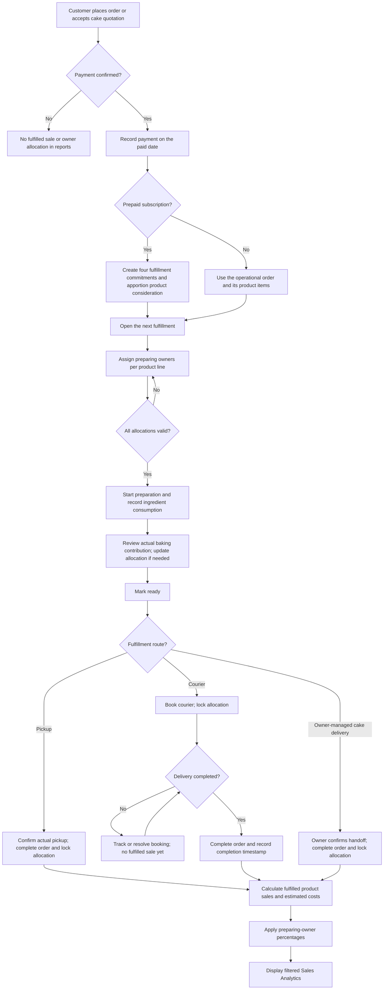

# Sales Analytics: full business flow

This document describes the agreed business process, the current prototype behavior, and the database design needed to persist it. It does not introduce new application behavior. Where a business rule is stronger than the prototype implementation, the gap is identified at the end.

## 1. Purpose and coverage

Sales Analytics answers how much product sales the bakery fulfilled, which owner prepared those products, and each owner's allocated sales and estimated profit. It also provides a separate view of payments received.

The attribution rule applies to custom cakes, ordinary bread and pastry orders, and bread and pastry fulfillments supplied through prepaid subscriptions. It is not based on which user changes the order status.

The allocation unit is one order-item line in one fulfillment. A line may contain several units. Its percentage applies to the whole line; it does not independently track who made each physical piece. Different products can have different owners, and later subscription deliveries can use different allocations. The change does not add a new subscription plan type or a mixed-product subscription builder: the existing subscription model is still one variant per subscription, with four deliveries.

## 2. People and responsibilities

| Actor | Responsibilities | Earnings entitlement |
| --- | --- | --- |
| Customer | Places an order or subscribes, pays, and receives the products | None |
| Owner A / Owner B | Bakes products; can record preparing owners and advance permitted operational statuses; reviews Sales Analytics | Receives the percentage assigned to the product they prepared |
| Staff | Records the actual preparing owners; starts preparation in the system, marks ready, confirms pickup, and books/follows courier delivery where permitted | None from these actions |
| System | Validates allocation, payment and operational prerequisites; tracks completion; calculates reports | None |

Only authorized owner accounts can access Sales Analytics. Staff can record attribution through operational screens, but do not gain access to the owner's financial dashboard. Both owner filters currently belong to the same owner workspace; the prototype does not implement separate private dashboards for two independently provisioned owner accounts.

## 3. Main flow



For subscriptions, repeat the fulfillment portion for each delivery. Failed or cancelled courier bookings can return to allocation review and rebooking while the order remains incomplete; they do not create fulfilled sales.

## 4. Order placement and payment

1. An ordinary order is placed, a cake quotation is accepted and paid, or a prepaid subscription purchase is paid.
2. The system records a successful payment with its actual paid timestamp. Failed, pending, expired, or cancelled payment attempts do not count as received payments.
3. The payment appears in Recorded payments for its paid date, even if production and delivery occur later.
4. A paid order is not yet a fulfilled sale. Paid orders still awaiting preparation, pickup, or delivery remain outside Fulfilled sales.
5. Payment-resolution cases are outside normal fulfilled processing. In the current recorded-payment implementation, a record flagged as paid can still appear while reconciliation is required; reporting it does not mean the issue is resolved.
6. A prepaid parent purchase is the payment source for its four fulfillment orders. The children do not request or create another subscription payment.

## 5. Preparing-owner assignment

Before starting preparation, an authorized staff member or owner identifies who will bake each product line.

| Selection | Owner A percentage | Owner B percentage |
| --- | ---: | ---: |
| Owner A | 100% | 0% |
| Owner B | 0% | 100% |
| Both owners, default | 50% | 50% |
| Both owners, adjusted example | 60% | 40% |

Rules:

- Every fulfillment item needs a preparing-owner selection before progressing through the normal production flow.
- When both owners are selected, Owner A's percentage must be a whole number from 1 to 99; Owner B receives the remainder. Percentages must total 100%.
- Clicking Start preparation, Mark ready, Confirm pickup, or Book courier does not itself grant an earnings share.
- One product line can have a different allocation from another line in the same order.
- Apply to all products copies the owner selection within that fulfillment. In the current UI, each line's existing split input is retained; review percentages individually when applying Both owners.
- An unselected product remains Unallocated. It is never silently assigned to the staff member, the signed-in owner, or an equal split.
- Editing allocation changes attribution, not the customer price or payment amount.

Assignment can be entered in order/production details or reviewed in status confirmations. The current UI displays the editor in unlocked single-order status confirmations and in subscription Start preparation / Mark ready batch confirmations. Reviewing an existing allocation does not require changing it.

## 6. Preparation and review

Starting preparation checks operational access, the expected order version, payment/status prerequisites, and material availability. Ingredients are recorded as consumed only when preparation starts successfully.

If another owner joins the baking work, staff or an owner can correct the allocation while the order is unlocked. For example, Owner A starts alone; Owner B later helps; the line changes from A 100% to A 60% / B 40%.

Mark ready confirms the products are prepared and staged. It does not complete the order and does not add the products to Fulfilled sales. Saved percentages carry forward; a fresh choice is not required solely because the status changes.

Saving from an old order version or a failed save must not overwrite newer work. Reopen/review the order and retry. A cancelled confirmation must not save its draft allocation.

## 7. Fulfillment and locking

| Situation | Allocation editable? | Counted as fulfilled sales? |
| --- | --- | --- |
| Confirmed, preparing, or ready; no active courier | Yes | No |
| Courier pending, booked, in transit, or unresolved | No | No |
| Courier failed/cancelled and order incomplete | Yes | No |
| Pickup actually confirmed completed | No | Yes |
| Courier delivered and order completed | No | Yes |
| Owner confirms a custom cake handoff completed | No | Yes |

Pickup: staff or an owner confirms pickup after handoff. The system sets Completed and a completion timestamp, then the item amounts enter Fulfilled sales.

Courier: a valid, paid, Ready order with preparing owners can be booked. Booking locks attribution; it is not the recognition point for fulfilled sales. Completion occurs when courier tracking reaches Delivered. The prototype simulates these courier updates through its existing local adapter.

Custom cake owner delivery: the owner confirms the handoff under the existing cake workflow. It does not use the standard/subscription courier booking flow.

An unresolved courier result stays locked until resolved. A failed/cancelled booking can allow correction and retry, but does not refund or cancel the customer payment automatically.

## 8. Prepaid subscription flow

The subscription payment and the work performed on each delivery are separate events.

Example: the customer prepays PHP 4,000 for products across four equal deliveries, plus PHP 400 delivery fees.

| Event | Recorded payment | Fulfilled product sales | Attribution |
| --- | ---: | ---: | --- |
| Upfront payment | PHP 4,400 | PHP 0 | No owner share yet |
| Delivery 1 completed | No new payment | PHP 1,000 | Owner A: PHP 1,000 |
| Delivery 2 completed | No new payment | PHP 1,000 | Owner B: PHP 1,000 |
| Delivery 3 completed | No new payment | PHP 1,000 | A: PHP 500; B: PHP 500 |
| Delivery 4 completed | No new payment | PHP 1,000 | A: PHP 600; B: PHP 400 |
| Totals | PHP 4,400 | PHP 4,000 | A: PHP 2,100; B: PHP 1,900 |

The PHP 400 delivery charge is outside owner product-sales allocation. These columns are different views of the same business activity and must not be added together.

For unequal item values, apportion the actual prepaid product total in proportion to original item quantities multiplied by their selling-price snapshots. For example, a PHP 900 product bundle with original product values PHP 600 and PHP 400 gives product amounts PHP 540 and PHP 360. The original subscription payment, not a later catalog price, determines the amount to distribute.

Keep calculation precision until currency rounding. Assign rounding remainders consistently so all delivery/product amounts equal the original prepaid product total, and owner shares equal each item's product amount. Deferring a delivery changes when it is fulfilled and reported, not its allocated subscription consideration. Incomplete deliveries do not enter Fulfilled sales.

## 9. Sales and estimated-profit calculations

For each eligible product line:

```text
Product sales amount = product consideration assigned to that line
Owner allocated sales = product sales amount x owner percentage
Estimated product cost = current ingredients + packaging + utility overhead
Owner allocated cost = estimated product cost x owner percentage
Owner estimated profit = owner allocated sales - owner allocated cost
```

Revenue is rounded in cents; any remaining cent is assigned consistently so the two owner shares sum to the line amount. Estimates can be negative when costs exceed product sales. Do not force a loss to zero.

Example: one cake has PHP 2,000 product sales and PHP 800 estimated cost, with a 60/40 split.

| Measure | Whole cake | Owner A | Owner B |
| --- | ---: | ---: | ---: |
| Product sales | PHP 2,000 | PHP 1,200 | PHP 800 |
| Estimated cost | PHP 800 | PHP 480 | PHP 320 |
| Estimated profit | PHP 1,200 | PHP 720 | PHP 480 |

The percentage describes the agreed earnings allocation. The system does not measure labor time or automatically infer a percentage from work performed.

Estimated profit uses current recipe/inventory cost estimates, so historical displayed profit can change when those costs change. Locking attribution freezes owner percentages, not historical cost estimates. Missing required cost data means profit is Unavailable, rather than assuming the cost is zero. Payroll, tax, owner withdrawals, and full accounting profit are outside this calculation.

## 10. Dashboard flow and filters

1. An authorized owner opens Sales Analytics.
2. The default is Fulfilled sales, all owners, all products, all order types, and the current month to date.
3. Select the sales basis, then the period and other filters.
4. The system selects eligible records, uses the corresponding business date, applies filters, calculates amounts, and refreshes the metrics and charts.

| Filter | Choices / meaning |
| --- | --- |
| Sales basis | Fulfilled sales or Recorded payments |
| Period | Day, week, month, quarter, year, or custom date range |
| Selection | The current period or a specific offered period; explicit dates for a custom range |
| Product | All products or selected products |
| Order type | All, standard orders, subscriptions, or custom cakes |
| Prepared by | All owners, Owner A, Owner B, or Unallocated; available only in Fulfilled sales |

Recorded payments uses the paid date. Fulfilled sales uses the actual completion date, not the order placement date, preparation date, scheduled delivery date, or booking date. Reporting dates use Asia/Manila business time. A subscription paid in November and completed in December appears in November's payment view and December's fulfilled view.

The owner filter is hidden in Recorded payments because an upfront payment cannot establish who will prepare every later fulfillment. Switching basis changes the population and dates being reported, so the totals need not match within the same calendar period.

Metrics and visualizations:

- Allocated sales: fulfilled product amount attributable to the selected owner, or all fulfilled product amounts under All owners. All owners includes Unallocated historical work.
- Recorded revenue: currently the payment view's product portion. Its chart/average can include delivery fees when no product filter is active; see the presentation limitation below.
- Estimated profit: the applicable product revenue less estimated production costs. In the payment view it is a payment-period product margin estimate, not a completed-work earnings report.
- Average purchase: selected report total divided by the count of matching operational orders or purchases. In the fulfilled subscription view, this counts matching fulfillment orders rather than unique subscribers.
- Units sold: full product quantities under All owners. Under a specific owner or Unallocated, Allocated units weights quantities by allocation. A 50% share of six pastries shows three allocated units; it is not proof that the owner physically baked exactly three pastries.
- Sales trend: daily, weekly, or monthly buckets depending on the date span.
- Sales by order type: standard, subscription, and custom cake amounts for the current selection.
- Top products: up to five products ranked by sales for the current selection.

Changing filters recomputes the report; it does not change stored attribution. Clear filters returns the defaults. A period with no matching completed work has no fulfilled sales, even if payments were received in that period.

## 11. Exceptions, corrections, and reconciliation

| Situation | Rule / expected handling |
| --- | --- |
| An item has no preparing owner | Require assignment in new operational work; historical unassigned completed items remain Unallocated |
| Split missing, outside its allowed range, or fractional | Reject the allocation; do not advance the affected order |
| Stock insufficient when starting preparation | Keep the order in its prior state and resolve materials before retrying |
| Order changed since the confirmation opened | Reject stale updates and ask the operator to review the current version |
| Save fails | Retain the prior saved allocation/status; retry after resolving the failure |
| Batch has mixed results | Show results per order; successful orders progress, failed orders retain their prior state and can be reviewed/retried |
| Courier only booked/in transit | Do not count fulfilled sales yet |
| Courier booking failed/cancelled | Keep unfulfilled sales out of the fulfilled report; allow correction/rebooking while incomplete |
| Order unpaid or cancelled | No fulfilled allocation; a prior successful payment is a separate reconciliation matter |
| Completion timestamp absent | Do not invent a fulfillment date; investigate missing data rather than placing it in an arbitrary reporting period |
| Permitted accidental status reversal | Remove the order from fulfilled reporting if it is no longer completed; recalculate on re-completion; retain audit history |
| Completed order has the wrong allocation | Normal editor is locked; a controlled correction/reopen policy is needed. No unrestricted completed-order edit or payout adjustment is introduced |
| Required cost data missing | Show estimated profit as Unavailable; retain the sales figure |
| Refund or owner payout needed | Handle through the business's external process; neither is automated by Sales Analytics |

Reconciliation rules:

```text
Owner A allocated sales + Owner B allocated sales + Unallocated sales
    = all fulfilled product sales for the same filters

All apportioned subscription fulfillment product amounts
    = the subscription's actual prepaid product total

Fulfilled-report chart buckets and product amounts
    = the same selected fulfilled-sales total
```

Allocation is a reporting entitlement, not evidence that cash has been transferred to an owner. Repeated viewing of a report does not generate another sale or payment.

## 12. Records and ERD mapping

| Record | Purpose |
| --- | --- |
| Account / AdminProfile | Identify actual owner accounts; the proposed is_baking_owner flag controls recipient eligibility |
| Order / OrderItem | Identify the fulfillment and its individual cake/product lines |
| OrderItemOwnerAllocation | Proposed persistent relationship between an item, its preparing owner, and share percentage |
| OwnerAllocationHistory | Proposed separate audit of old/new allocations and the account recording the change |
| OrderStatusHistory | Records operational status changes and the acting account |
| Payment | Records payment events on the purchase order |
| Subscription / SubscriptionDelivery | Connect the prepaid purchase to its four fulfillment orders |
| Delivery | Records booking and completion information for courier fulfillment |
| ProductBOM / Inventory / PricingConfig | Supply current ingredient, packaging, and overhead estimates |

The ERD adds completion/lock timestamps on Order and net_product_amount_snapshot on OrderItem. The latter preserves each line's apportioned product consideration for persistent reporting. Analytics is calculated from these records; a separate Analytics table is not required.

## 13. Current prototype boundaries and implementation gaps

- Owner allocation currently lives on browser-side operational orders with Owner A / Owner B labels. The new ERD entities, real owner identities, lock timestamp field, and persistent net product amount snapshots are a database design, not deployed tables or migrations.
- Details-screen edits currently write a message to existing status history. Full independent before/after allocation audit records are specified in the ERD but are not implemented in the prototype. Do not describe the current audit as a complete allocation ledger.
- The editor validates every line when submitting a selection. Some saved-allocation transition/booking guards currently check only that an allocation array exists, rather than revalidating every saved row. Complete server-side validation remains necessary.
- Current-cost estimated profit is not historical accounting profit. Financial figures still require end-to-end browser verification and production validation; the existing automated checks cover selected allocation/reporting cases, not every recipe, mixed-owner order, or payment exception.
- The Recorded payments view currently mixes a product-only revenue card with totals including delivery fees in the unfiltered chart/average. Some chart labels and empty-state text also still use payment wording in Fulfilled sales. A later UI cleanup should make these distinctions explicit; this document does not change that UI.
- Existing completed, unallocated records are visible but locked. Backfilling those records needs an explicitly designed correction/migration process; normal staff editing is not a substitute.
- Subscription product amounts are currently calculated at report time from the purchase snapshot and child item values. The ERD proposes persisting them. Stable rounding order and immutable price snapshots must be enforced in the backend.
- There is no automated payout, staff commission, payroll, refund processing, or historical closing/reconciliation workflow added by this feature.

Related design: [ERD](../Chapters/ERD.md). Implementation overview: [Sales Analytics and preparing owners](sales-analytics-allocation.md).
